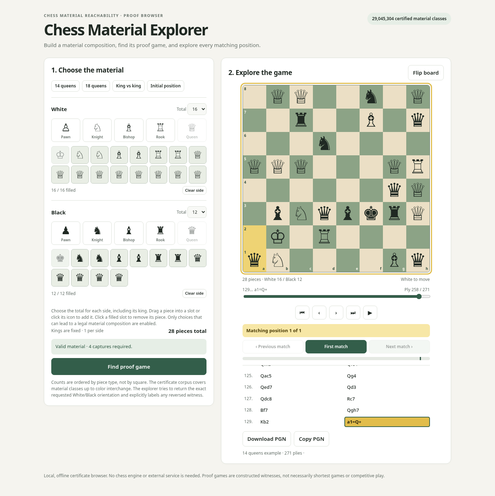

# Chess Material Reachability

**A reproducible, computer-assisted proof of which material configurations can occur in standard chess.**

This project characterizes reachable material counts, not individual board positions. Given the numbers of pawns, knights, bishops, rooks and queens for each side (with one king each), it asks whether a legal game from the standard starting position can reach that material.

The certificate corpus and exact-set checker establish **29,045,304 reachable material classes**, across 2–32 pieces, **up to exchanging White and Black**. This is precisely the candidate set of Tomic's criterion, as reported by [Kirill Kryukov](https://kirill-kryukov.com/chess/counting-chess-endgames/). The count itself is prior work; the contribution here is auditable constructive evidence of sufficiency. No claim of first-ever proof or independent peer review is made.

> **Scope:** The proof treats a material pair as unordered. It does not prove that all 58,084,310 color-oriented candidates are reachable in both orientations. Nor does it establish reachability of every board diagram with a valid material count. The Explorer tries the requested orientation and explicitly identifies any color-reversed witness.

## Try the interactive Explorer



Choose the number of pieces on each side, fill the slots by dragging or clicking pieces, and select **Find proof game**. Invalid choices are disabled. The program reconstructs a concrete witness from the proof certificates, jumps to the first matching position, highlights every matching position in the game, and exports PGN. Use the move list, slider, playback and match navigation to inspect the game.

The Explorer runs locally and needs the full certificate corpus; no accounts, external chess engine, or network API are required. A static GitHub Pages site cannot run this Python backend. See [Explorer guide](EXPLORER.md) for controls and limitations.

## Installation

Requirements: Python 3.10 or newer, NumPy, a C++17 compiler and the `zstd` executable. Use a virtual environment. The reference replay was performed on Linux; macOS setup instructions use the same commands (install Apple's command-line tools with `xcode-select --install` if needed). Windows users can use WSL with the Linux instructions. The current reference tests were run on Linux, not native macOS or Windows.

**macOS** (with Homebrew):

```sh
brew install zstd
```

**Debian / Ubuntu / WSL:**

```sh
sudo apt-get update
sudo apt-get install -y python3 python3-venv g++ zstd
```

From the extracted repository or a Git clone:

```sh
python3 -m venv .venv
source .venv/bin/activate
python -m pip install -r requirements.txt
```

On macOS, set `export CXX=clang++` if the default compiler is unavailable. Allow at least 2 GB of free disk space for decompression and derived indexes. Do not use `python -O`: the verification code relies on assertions.

### Launch the Explorer

```sh
python explorer.py
```

The first launch runs the full verifier to build a fresh `replay/` directory. Depending on the machine this can take minutes or longer. When it finishes, open <http://127.0.0.1:8765/>. Subsequent launches reuse the generated indexes. Stop the server with Ctrl+C. If the default port is occupied, use `--port 8766`. If an interrupted run left a partial replay directory, choose a new one, e.g. `python explorer.py --replay replay2`.

Command-line witness export (P,N,B,R,Q; kings implicit):

```sh
python explorer.py --query 0,2,2,2,9 0,2,2,2,5 > witness.pgn
```

### Reproduce the entire proof

```sh
python verify.py
```

The work directory must be new. If the Explorer already built `replay/`, use `python verify.py --work replay-fresh` for an independent cold run. The verifier checks the compressed and raw SHA-256 digests, compiles the checkers, validates the raw game and symbolic certificates, reconstructs the coverage sets and tests equality with the mathematically computed candidate relation. It does not trust a cached coverage matrix, prior result table, or precomputed family index as proof input. The expected table is an additional regression check.

Expected final lines:

```text
Total   29045304  29045304  0
PASS: exact set equality, rebuilt from certificate outputs.
PASS: all 29,045,304 candidates reconstructed from compact certificates, no historical archives or cached coverage.
```

`replay/summary.tsv` contains the per-size result, and `replay/VERIFIED.json` marks successful completion. The generated files are not included in Git. See [Reproducibility](docs/REPRODUCIBILITY.md) for details, historical audits and review guidance.

### Quick checks (not a full proof replay)

```sh
python -m unittest discover -s tests -v
python src/upper_bound.py
python examples/small/check.py
python src/check_example.py
```

Run Explorer integration tests after a completed replay:

```sh
python explorer/smoke_test.py replay
```

GitHub Actions runs quick checks on pushes and pull requests. A separate manually triggered workflow performs a cold proof replay and uploads its summary and log. Quick checks alone do not establish sufficiency.

## Mathematical statement

Write a side's profile as `t = (P,N,B,R,Q)`, excluding its king. Let `o = (2,2,2,1)` be the original N,B,R,Q counts, `u(t) = Σ max(t_i − o_i, 0)` over those four types, `d(t) = 8 − P − u(t)`, and `l(t) = 15 − Σt_i`. For White and Black, let `C = l(W) + l(B)` (the number of captures).

A profile pair is admissible precisely when all counts are nonnegative, `d >= 0` and `l >= 0` on both sides, and

- `u(W) <= C + d(B)`;
- `u(B) <= C + d(W)`.

The [paper](docs/PAPER.md) proves necessity and derives the count; the certificate-based verification establishes sufficiency for unordered pairs. The proof permits a terminal target, but no move after an automatically terminal position. The witness histories are cooperative, not optimal-play claims.

Selected results (full table: [results/expected.tsv](results/expected.tsv)):

| Total pieces | Reachable classes |
|---:|---:|
| 2 | 1 |
| 8 | 2,520 |
| 16 | 393,114 |
| 25 | 4,243,148 |
| 26 | 3,783,484 |
| 27 | 2,178,319 |
| 28 | 613,655 |
| 29 | 83,625 |
| 30 | 6,090 |
| 31 | 155 |
| 32 | 1 |
| **All 2–32** | **29,045,304** |

## Repository map

| Location | Purpose |
|---|---|
| [`docs/PAPER.md`](docs/PAPER.md) | Research manuscript: definitions, theorem, proofs, results, references |
| [`docs/RELATED_WORK.md`](docs/RELATED_WORK.md) | Prior work and priority limitations |
| [`docs/CERTIFICATES.md`](docs/CERTIFICATES.md) | Raw record grammar and soundness invariants |
| [`docs/ARCHITECTURE.md`](docs/ARCHITECTURE.md) | Pipeline, responsibilities and trust boundaries |
| [`data/`](data/README.md) | Nine compressed streams: 309,421 games, 66,473 templates and 420 storage records; integrity manifest |
| [`src/`](docs/ARCHITECTURE.md) | Move checkers, symbolic validators, candidate enumeration and exact coverage union |
| `verify.py` | Cold replay orchestration |
| [`explorer/`](EXPLORER.md), `explorer.py` | Local browser UI, witness lookup, reconstruction, PGN and smoke tests |
| [`examples/`](examples/README.md) | Concrete 14-queen PGN and small terminal-target witnesses |
| [`proof/`](proof/README.md) | Supplementary constructive modules and historical conditional reductions |
| [`results/`](results/README.md) | Expected counts, replay evidence, environment and audit logs |
| [`tests/`](tests/) | Quick regression tests |
| [`.github/workflows/`](.github/workflows/) | Quick CI and manual full-replay CI |

All full-proof inputs are included. No old four-archive chain, external historical corpus, generated cache or proprietary service is required. The archive contains *certificates and verification code*, not a general from-scratch search program that regenerates every certificate without the supplied data. The selected corpus is sufficient, not proven minimal.

## Citation, authorship and reuse

See [related work](docs/RELATED_WORK.md) and [references.bib](docs/references.bib) for prior sources. The investigation was human-directed with substantial assistance from OpenAI ChatGPT; see [AI assistance](AI_ASSISTANCE.md). The evidence is the source code and certificates, not an AI assertion. Independent scientific review remains welcome.

**Author:** Kanstantsin Palitai. Citation metadata is available in [`CITATION.cff`](CITATION.cff).

**Licenses:** original software under MIT, original certificate data under CC0 1.0, and original manuscript and documentation under CC BY 4.0. See [license scope and full texts](LICENSE.md) for details and third-party exclusions. See [GitHub publishing instructions](docs/PUBLISH.md) for repository setup.
