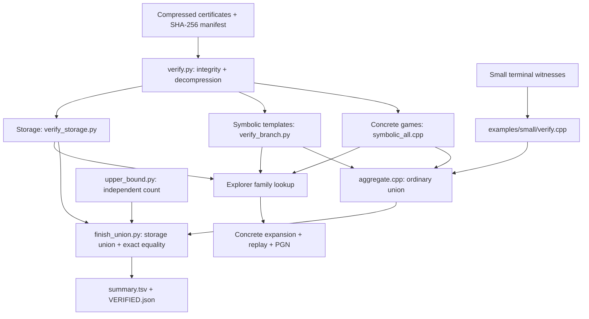

# Architecture and verification boundaries

## Full proof pipeline

The raw inputs are 309,421 concrete move sequences, 66,473 branch templates and 420 storage records in nine streams. `examples/small/` adds the small witnesses; these input record counts are not counts of distinct profiles. The ordinary checker emits families of material counts at supported positions, not just the final positions. A verified common mating suffix certifies that its prefixes are non-dead. The terminal-target checks use alternative mating continuations. See [certificate grammar](CERTIFICATES.md) for soundness details.

## Source map

| File | Responsibility |
|---|---|
| `verify.py` | Orchestrate checksum validation, compilation, decompression and fresh replay. Refuse existing work directories. Write completion marker only after exact equality. |
| `src/upper_bound.py` | Enumerate 8,694 individual profiles, group by 324 triples and independently count candidates. |
| `src/verify28.cpp` | Low-level concrete move and attack rules used by the C++ symbolic checker; legacy standalone driver is not the full verifier. |
| `src/symbolic_all.cpp` | Validate concrete games ending in mate and derive sound promotion-choice families. |
| `src/verify_base.py` | Python board representation, moves, attack checks, promotion and helper primitives. |
| `src/verify_special.py`, `src/verify_branch.py` | Parse templates, check type-specific routes, common endpoints, symbolic legality and suffixes; emit families. |
| `src/storage_prefix.py`, `src/verify_storage.py` | Check storage/deletion geometry and service-knight routes; emit supported rectangle parameters. |
| `src/aggregate.cpp` | Expand ordinary families, union canonical profile pairs and create fresh coverage state. |
| `src/finish_union.py` | Add supported storage rectangles, reject noncandidate coverage, check exact candidate row equality, save missing profiles on failure. |
| `explorer/lookup.cpp` | Search family indexes for requested material. |
| `explorer/engine.py`, `explorer/storage_details.py` | Choose promotion types, expand routes, reconstruct concrete histories and export PGN. |
| `explorer.py`, `explorer/index.html` | Local HTTP server and browser client. |

## Trust and limits

The proof does not depend on the Explorer. A successful proof replay checks unordered material classes; a successful Explorer request demonstrates one actual oriented witness (or an explicitly labeled reverse-orientation witness). The Explorer does not exhaustively query all classes. Its completion marker identifies the manifest and summary, not a cryptographic signature of every derived index. For independent verification, always run a cold replay on trusted source code and raw inputs. A matching total alone would be insufficient; the full checker compares exact sets and rejects noncandidate coverage.

The historical experiments in `proof/` and `results/` help explain the construction but are not required inputs for the full proof, except the small witnesses in `examples/small/`. No general search-from-scratch generator for the full corpus is supplied. This is a reproducible computer-assisted result, not a replacement for mathematical review of the symbolic invariants.
