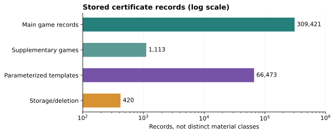
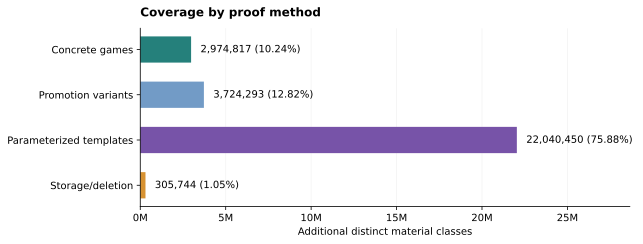
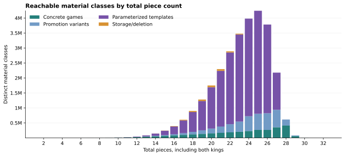

# Certificate and coverage statistics

This analysis supplements the exact-set proof described in [PAPER.md](PAPER.md). It measures the retained corpus, not the space of all possible chess games, or the minimum number of witnesses required.

## Stored records

| Input | Records |
|---|---:|
| Main UCI game streams | 309,421 |
| Parameterized template blocks | 66,473 |
| Storage/deletion blocks | 420 |
| Main corpus subtotal | 376,314 |
| Supplementary mate-game lines | 1,110 |
| Supplementary terminal-branch lines | 3 |
| **Total records across these inputs** | **377,427** |



Record counts are not distinct profile counts or necessarily globally unique game sequences. The three terminal branches are not mate-ending games. Illustrative files elsewhere in the repository are not added as independent proof inputs.

## Incremental coverage

| Proof method | Newly covered classes | Share of total |
|---|---:|---:|
| Concrete game positions | 2,974,817 | 10.24% |
| Additional promotion variants of main games | 3,724,293 | 12.82% |
| Additional parameterized templates | 22,040,450 | 75.88% |
| Additional storage/deletion certificates | 305,744 | 1.05% |
| **Total** | **29,045,304** | **100%** |





The number of pieces includes the two kings. Colors are unordered. Percentages are relative to the total, rounded independently.

### Counting protocol

1. **Concrete:** replay all 309,421 main game records and all 1,113 supplementary lines, recording the initial profile and profiles after captures or promotions. Other moves cannot change material. Deduplicate canonical unordered keys. The main streams alone cover 2,971,922 classes; the supplementary lines add 2,895.
2. **Game variants:** add the verified `.families` outputs of `symbolic_all.cpp` for the main games, expanding only the permitted promotion domains. The cumulative union contains 6,699,110 classes.
3. **Parameterized templates:** add the verified `.families` outputs of `verify_branch.py`. The cumulative union contains 28,739,560 classes.
4. **Storage/deletion:** compare the preceding union with the final exact verified relation of 29,045,304 classes; the remaining 305,744 are credited to the storage phase. The primary verifier proves the set equality, not merely the count.

Each stage contains the preceding stage; each row is the difference of successive union cardinalities. A class supported by multiple methods is counted once, at its earliest stage. A different ordering gives a different attribution. The proof verifier's `ordinary_summary.tsv` credits supplementary witnesses only at 2–7 pieces; this analysis credits all their prefixes, so the pre-storage count is one larger than the original 28,739,559. Both yield the same final set. No certificate was modified or newly assumed valid.

### Reproduce

From the repository root, use a completed cold replay produced by `verify.py` (use a new directory if needed):

```sh
python verify.py --work replay-stats
python src/coverage_statistics.py --replay replay-stats --output results/coverage_breakdown.tsv
```

The analysis uses validated raw UCI records and derived family files from the completed replay. It checks the manifest, raw file hashes and final summary marker; it does not independently validate every family file against its original template. The cold replay is the trusted source of these files. The script replays concrete moves using the existing move implementation, expands the families through the existing aggregator, checks monotonic cumulative counts and reconciles the per-size totals. The full verifier remains the authority for legality, terminal histories and exact set equality. Do not substitute this analysis for verification.

To regenerate the SVG plots (optional Matplotlib dependency, not required for proof or Explorer):

```sh
python -m pip install matplotlib
python src/plot_coverage.py
```

[TSV data](../results/coverage_breakdown.tsv) contains the disjoint incremental counts for each size 2–32 and the total. The SVG graphics are derived from it, with record counts separately taken from the corpus metadata and the small-witness input line counts.
